# Mermaid diagrams

Each ```` ```mermaid ```` block below should show as a diagram. Click into one, or arrow into it, to see and edit its code; move the cursor away and the diagram comes back. Switch themes to see the colors follow.

## Flowchart

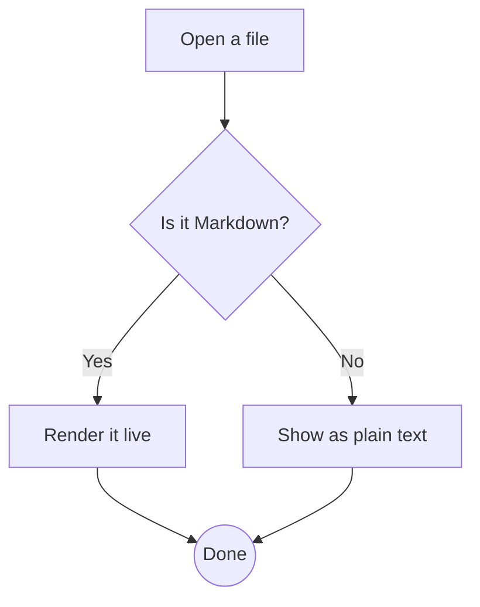

## Flowchart with groups, left to right

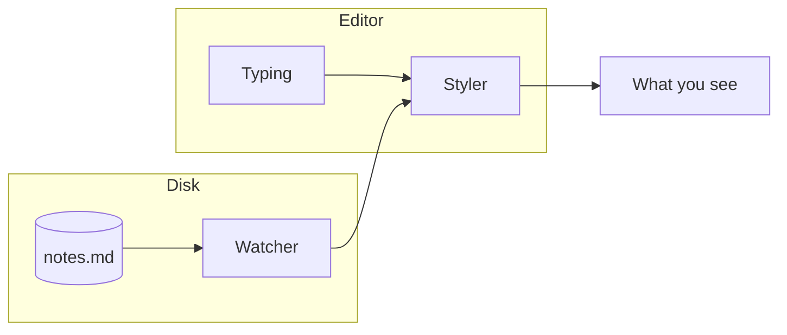

## Sequence diagram

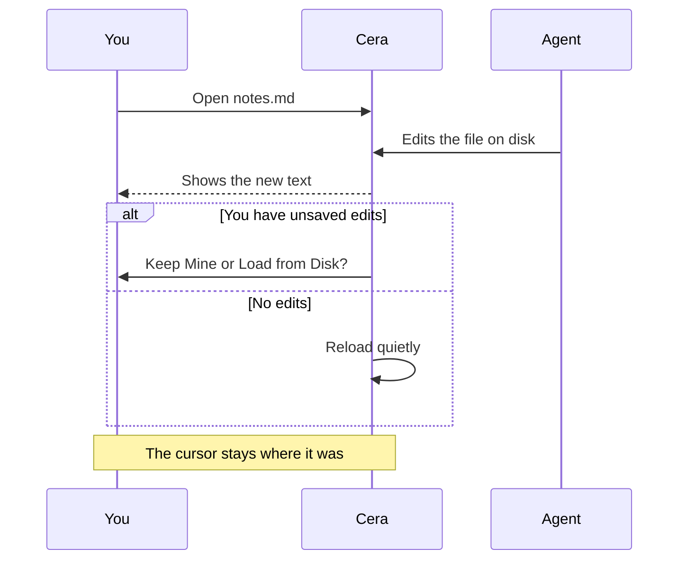

## Class diagram

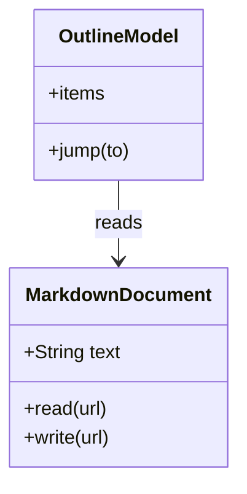

## State diagram

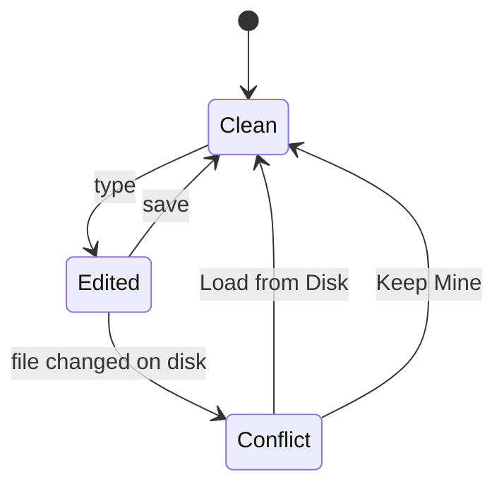

## Entity relationship diagram

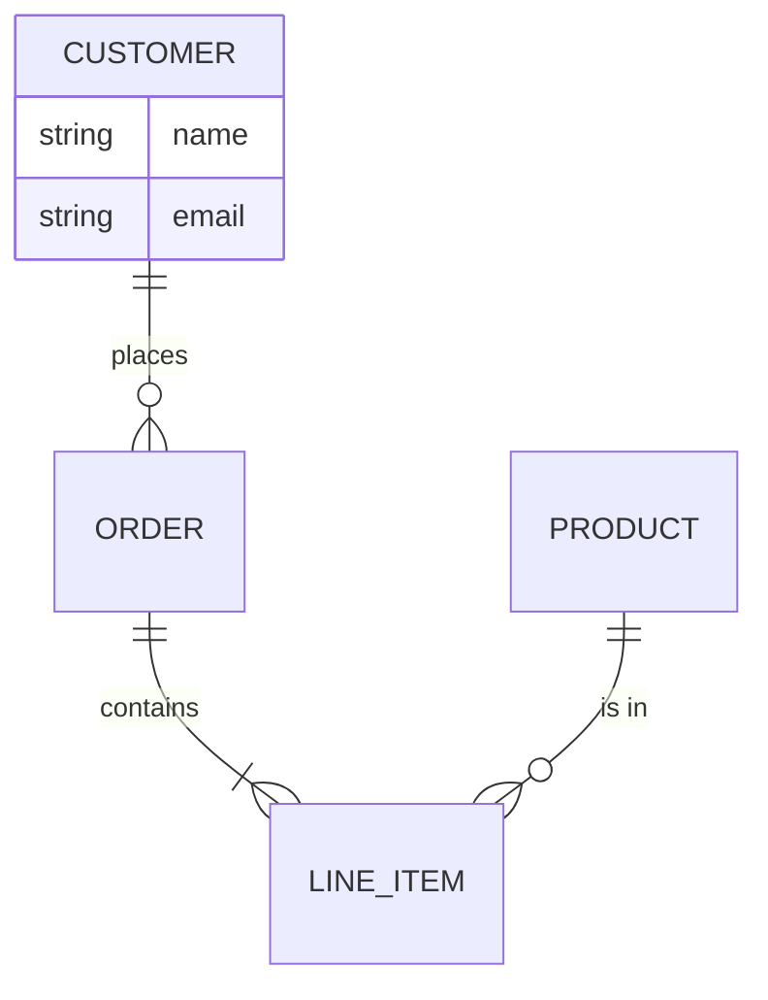

## Gantt chart

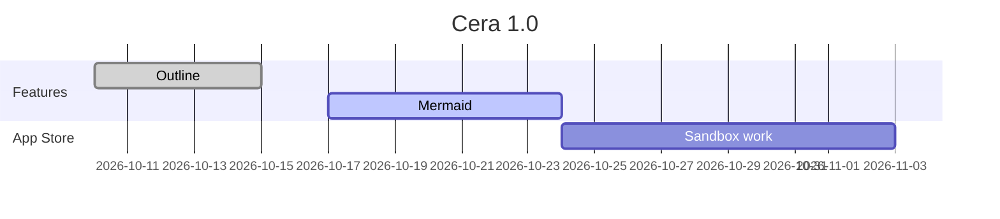

## Pie chart

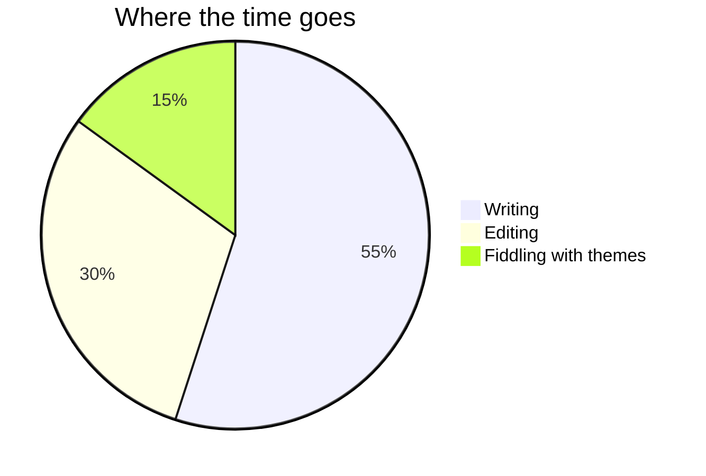

## Mindmap

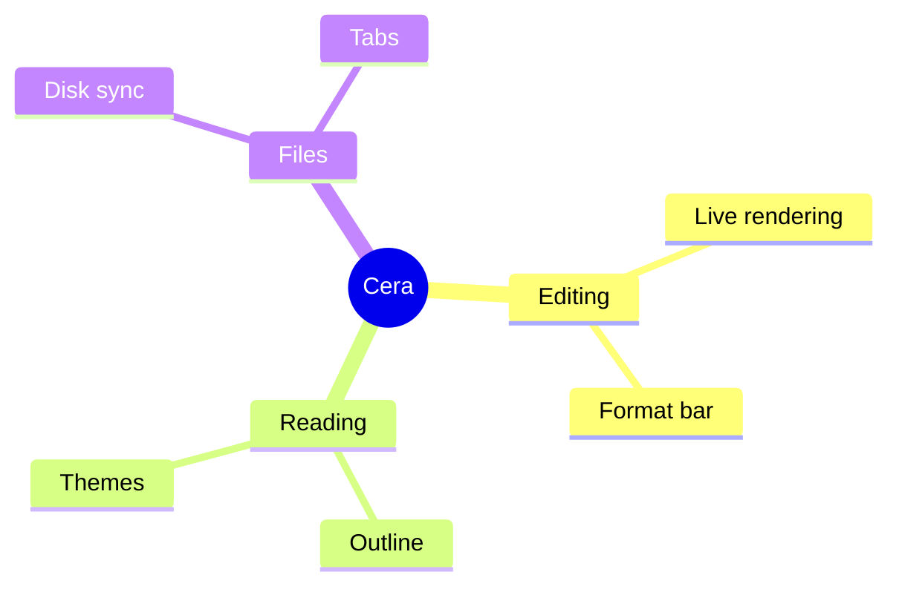

## User journey

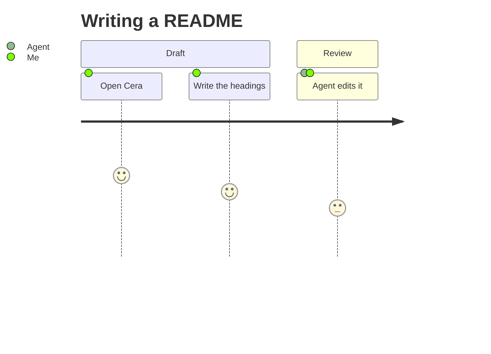

## Timeline

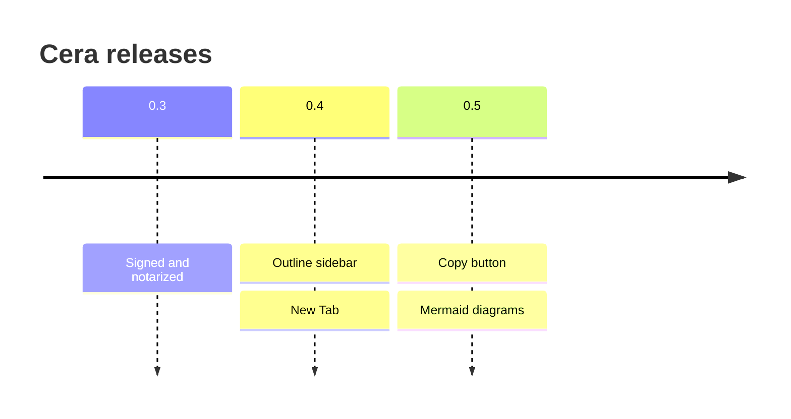

## A wide diagram

It shrinks to fit the column. Make the window narrower and it shrinks with it.

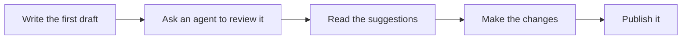

## Nested in a quote and a list

> A diagram inside a quote:
>
> ```mermaid
> flowchart LR
>     Q[Quoted] --> R[Still drawn]
> ```

- A diagram inside a list item:

  ```mermaid
  flowchart LR
      L[Listed] --> M[Indented with the item]
  ```

## Other fence styles

Tildes, and the language name in capitals, work too:

~~~Mermaid
flowchart LR
    T[Tilde fence] --> U[Drawn]
~~~

## Blocks that stay code

A diagram with a syntax error stays a code block, so nothing is lost:

```mermaid
flowchart TD
    A[Unclosed bracket --> B
```

So does a type of diagram Cera doesn't know:

```mermaid
notADiagram
    this stays code
```

Mermaid's own colors (`classDef` and `style`) are ignored; the diagram uses the theme's colors:

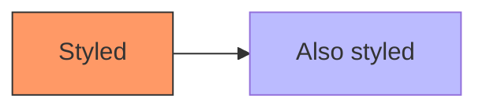

And a block that isn't Mermaid is just code:

```swift
let diagram = "not a diagram"
```
